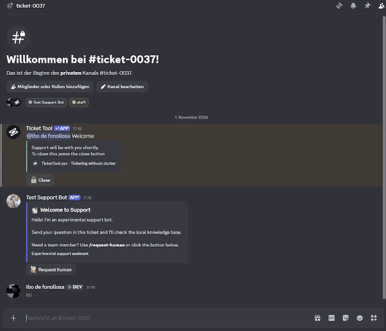

# AI driven Discord Ticket Support Bot

A  Discord support bot built in Python that utilizes a local knowledge base to automatically answer community questions accurately.

The bot works inside support tickets created by Ticket Tool (as of now for testing, can be used globally).. It finds known questions in a user's message, answers them from a local FAQ, adds a clearly labelled experimental AI answer that is limited to the matched FAQ text, and hands over to the human support team when needed.

> **Status:** learning and demonstration project. In Development... It is built and tested on a private Discord test server



The demo shows a greeting, a question hidden in the middle of a long message, and a message with three questions. Watch the full demo (ticket handover, closing and feedback) on [YouTube](https://youtu.be/k6Fz933vBEI).

## Features

- **Questions anywhere in a message.** A local keyword search splits a message into sentences and checks each part. A question in the middle of a long, messy message is found. Up to 3 questions per message are answered.
- **FAQ answer first.** Matching entries of `knowledge.json` are sent as the primary answer, with the source URL in the footer.
- **Grounded AI answer.** The AI (Gemini or Groq used as of now, as times passes OpenAI APIs are going to be included, which will have this entire system work much better) only receives the matched questions and the matched FAQ entries, never the whole message. It must answer from that text and say "I don't know" otherwise. In that case the bot points to the human support team.
- **No match, no AI.** If nothing matches, the bot sends a fixed message and does not call the AI. Greetings and thanks get a short friendly reply.
- **Human handover.** `/request-human` or the **Request human** button in the welcome message pings the support role and pauses automated replies in that ticket. Staff can resume with `/resume-bot`.
- **Ticket closing.** The person who asked can press **Thanks, my question was answered** and confirm. The bot then sends the Ticket Tool commands `$close`, `$transcript` and `$delete` with a short pause between them.
- **Feedback.** When a ticket is deleted, the person who opened it gets a direct message with 1 to 5 stars and a "No thanks" button. Only one answer per ticket is possible. Ratings are posted to a feedback channel.
- **Other commands.** `/ping` and `/ask`.

## How it works

```
Message in a ticket
        |
        v
knowledge_search.py   split into parts -> find questions -> match keywords
        |
        +-- no match ----> fixed "No matching answer found" message (or smalltalk reply)
        |
        +-- match -------> FAQ embed(s) with source (+ "Thanks" button)
                               |
                               v
                           AI backend (gemini_backend.py or groq_backend.py)
                               |
                               v
                           "Experimental AI response" embed
```

## Project structure

| File | Purpose |
|---|---|
| `main.py` | Discord client, events, slash commands, handover logic |
| `knowledge.json` | Local FAQ entries (keywords, answer, source URL) |
| `knowledge_search.py` | Finds questions in messages and matches them to entries |
| `gemini_backend.py` | Gemini backend (`ask_gemini`) |
| `groq_backend.py` | Groq backend (`ask_groq`) |
| `ticket_actions.py` | "Thanks" button and ticket closing with Ticket Tool commands |
| `feedback.py` | Feedback direct message, star buttons and feedback channel post |
| `embed_theme.py` | Shared embed design |
| `gemini_test.py` | Tests the Gemini backend without Discord |
| `.env.example` | Template for the local configuration |

## Setup

Requirements: Python 3.10 or newer (developed with 3.15.2), a Discord application with a bot.

1. **Create the environment** (Windows PowerShell):

   ```powershell
   python -m venv .venv
   .\.venv\Scripts\Activate.ps1
   pip install -r requirements.txt
   ```

2. **Create the Discord bot.** In the Discord Developer Portal, create a bot, copy its token and enable the **Message Content Intent**. Invite it with the scopes `bot` and `applications.commands`. It needs these permissions: View Channels, Send Messages, Embed Links, Read Message History, and Mention Roles (or the support role must be mentionable).

3. **Configure Ticket Tool. (if you want to use Ticket Tool)** The bot reads the Ticket Tool welcome message to find out who opened a ticket. Ticket Tool must also accept commands sent by other bots, because the bot sends `$close`, `$transcript` and `$delete`.

4. **Create the configuration.** Copy `.env.example` to `.env` and fill in your values:

   ```powershell
   copy .env.example .env
   ```

   | Variable | Meaning |
   |---|---|
   | `DISCORD_TOKEN` | Bot token |
   | `TEST_GUILD_ID` | Server where commands are synced and tickets are handled |
   | `TICKET_CATEGORY_ID` | Category that contains the tickets |
   | `STAFF_ROLE_ID` | Support team role (ignored by the bot, pinged for handover) |
   | `FEEDBACK_CHANNEL_ID` | Channel for star ratings |
   | `TICKET_TOOL_BOT_ID` | Optional, defaults to the public Ticket Tool bot that I used |
   | `AI_PROVIDER` | `gemini` or `groq` (default `groq`) |
   | `GEMINI_API_KEY` / `GROQ_API_KEY` | Key of the selected provider |

5. **Start the bot:**

   ```powershell
   python main.py
   ```

   The terminal shows "Bot is online as: …" and the number of synced commands.

To test only the AI backend without Discord:

```powershell
python gemini_test.py
```

## Testing

Use a private test server, a throwaway ticket and invented questions. Use one account without the staff role and one with it.

| # | Action | Expected result |
|---|---|---|
| 1 | Open a ticket | Welcome embed with a **Request human** button |
| 2 | `Is AzubiVerse free?` | FAQ answer with button, then the experimental AI answer |
| 3 | A long message with a question in the middle | The question is found and answered |
| 4 | Several questions in one message | Up to 3 FAQ answers and one AI answer |
| 5 | `Does AzubiVerse offer a free certificate?` | FAQ answer, AI says it does not know and points to `/request-human` |
| 6 | `thanks, have a nice day` / `hi` | Friendly short reply |
| 7 | A message without a known question | "No matching answer found", no AI call |
| 8 | A message from a staff member | No reaction |
| 9 | `/request-human` or the button | Support role is pinged, the bot stops answering |
| 10 | Staff uses `/resume-bot` | The bot answers again |
| 11 | Close the test ticket with the **Thanks** button | `$close`, `$transcript`, `$delete` are sent |
| 12 | Check the direct messages | Feedback request with star buttons |
| 13 | Press a star, then try again | One rating in the feedback channel, all buttons locked |

## Known limitations

- **Keyword search, not meaning.** The search matches keywords. A question without any known keyword is not found. Embeddings could be a future step.
- **Not every sentence is analysed deeply.** Only sentences that look like questions are checked, so some statements are ignored.
- **The AI can be wrong.** Its answer is labelled experimental. It is limited to the matched FAQ text, but this is a prompt instruction and no guarantee.
- **Free API tiers have limits.** Gemini was sometimes slow or unavailable (503/504 errors). If the AI fails, the FAQ answer is already sent and the error is only written to the terminal.
- **The transcript is not verified.** The bot waits 4 seconds between `$close`, `$transcript` and `$delete`. This does not prove that the transcript was saved before the ticket is deleted. Use test tickets only.
- **Feedback request after deletion.** The feedback request is sent when the ticket channel is deleted. Only tickets opened while this version runs have a known owner. If the person blocks direct messages, no request is sent.
- **German source, English bot.** The knowledge base is based on the German website, the answers are English. Only a few German keywords are included.
- **Single test server.** The bot is configured for one server and one ticket category.

## Privacy and data

- The AI provider receives only the matched question sentences and the matched FAQ text. Check the current terms of your provider and tier before using real user data. Do not use confidential or personal ticket content.
- The bot stores data locally in `handoffs.sqlite3` (not part of the repository): the channel IDs of tickets with a human request, the user ID and channel name of the person who opened a ticket, and feedback ratings with the user ID.
- Secrets belong in `.env`. This file is excluded by `.gitignore` and must never be committed.

## Knowledge base

The entries in `knowledge.json` are based on the public pages of [azubiverse.com](https://azubiverse.com).
